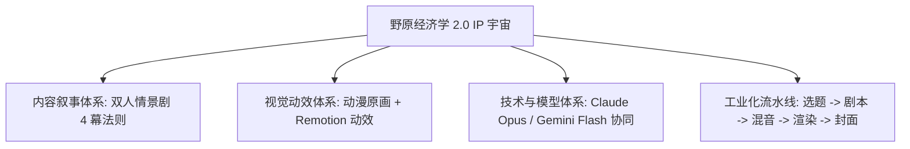
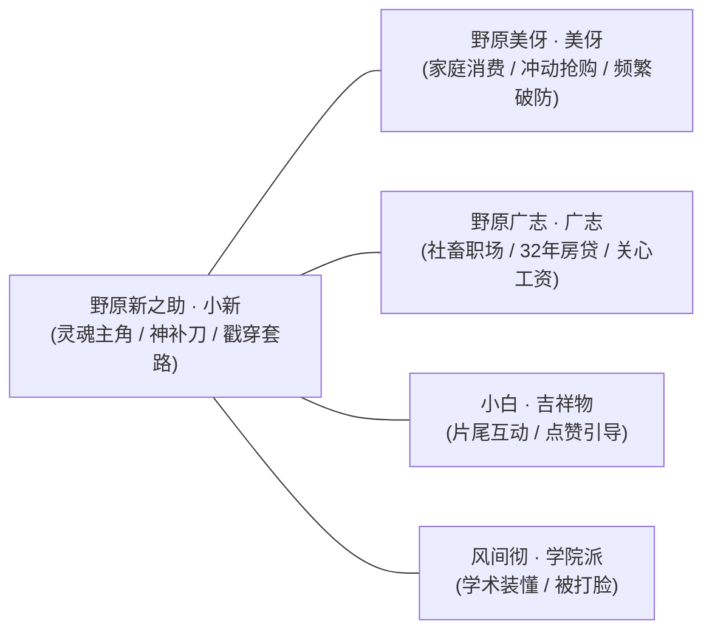
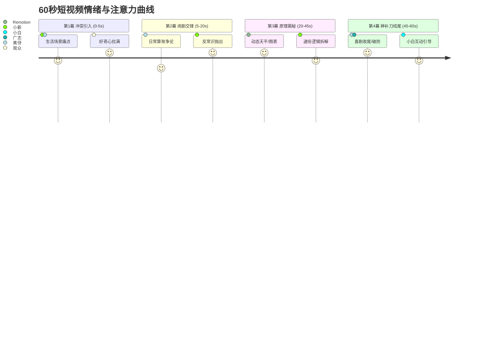
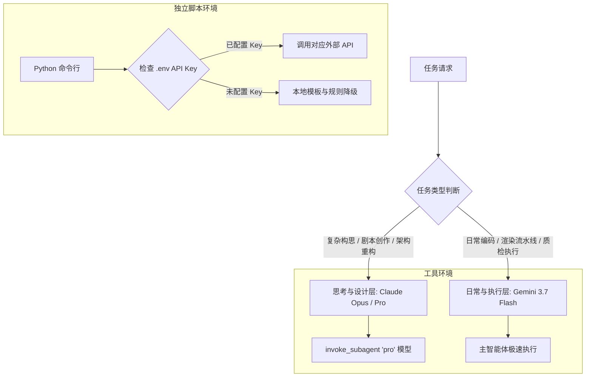

# 《野原经济学 2.0》全方位升级规划与系统构想方案

> **版本**：v2.0.0 Architecture & Strategic Blueprint  
> **核心定位**：看野原家闹剧，懂生活经济学（蜡笔小新 IP · 双人情景剧 · 涂鸦动效体系）  
> **目标人群**：年轻打工人、都市家庭、学生党、日常消费者  
> **主攻平台**：抖音 · 小红书 · 微信视频号（竖屏 1080×1920 / 30fps / 45~65s）

---



---

## 一、 升级背景与核心复盘

### 1. 1.0 版本痛点总结
- **形式单一**：1.0 采用单人讲课式（单角色居中+纯口播），完播率与前 3 秒留存率受限；
- **缺乏 IP 辨识度**：原创小人物缺乏天然受众认知基础，吸睛门槛较高；
- **视觉静态单调**：画面元素运动少，容易产生视觉疲劳。

### 2. 2.0 升级的核心突破
- **IP 降维打击**：全面升级为国民级动漫 IP **【蜡笔小新·野原一家】**，天然具备高国民度、幽默感与家庭生活代入感；
- **双人对手戏**：由“单人科普”变为“小新 vs 美伢/广志”的日常闹剧与对白交锋，冲突感更强，前 3 秒 Hook 转化率显著提升；
- **正版动漫高清质感**：彻底摒弃早期简笔几何图形，全量接入高分辨率（1520×2212）官方原版插画与透明抠图素材；
- **动效与交互进化**：引入角色呼吸微动、情绪冲击震屏、动态数据天平/对比滑块，以及黑黄警示胶带爆款封面体系。

---

## 二、 角色矩阵与人设定位



| 角色 | 视觉形象 | 核心功能 & 叙事定位 | 情绪状态库 | 经典台词 / 记忆点 |
| :--- | :--- | :--- | :--- | :--- |
| **小新 (Shinnosuke)** | 红衣黄裤、标志粗眉、圆润大头 | **灵魂主角**：童言无忌、一语道破天机，戳穿商家包装与成人借口，负责反转与点题 | `smile`, `explaining`, `thinking`, `shocked`, `smug`, `confused` | *"诶？美伢，第二件半价你真的赚了吗？"* / *"嘿嘿，你又被套路啦！"* |
| **美伢 (Misae)** | 经典卷发、粉紫家居服、主妇造型 | **消费/家庭担当**：精打细算却频频踩坑、热衷打折促销、容易破防追打小新 | `shopping`, `angry`, `calculating`, `shocked`, `smile`, `crying` | *"什么？！我买了两大箱居然亏了！"* / *"新之助！！"* |
| **广志 (Hiroshi)** | 西装社畜/居家衬衫、疲惫但温暖的大叔 | **职场/社畜担当**：背负32年房贷、零花钱少、关心工资条、通胀与年终奖 | `tired`, `shocked`, `thinking`, `smile`, `crying` | *"唉，这个月到手工资怎么又变少了..."* / *"我的零花钱啊..."* |
| **小白 (Shiro)** | 白色棉花糖小狗、歪头卖萌 | **片尾吉祥物**：互动收尾、引导点赞转发、经典转圈 | `happy`, `wondering`, `rolling` | *"汪！明天也要来看哦！"* |
| **风间 (Kazama)** | 蓝西装精英小孩、傲娇自信 | **学院派配角**：摆专业术语装懂，被小新通俗大白话无情打脸 | `proud`, `confused`, `shocked` | *"根据经济学原理，这叫做价格歧视！"* |

---

## 三、 爆款内容叙事法则：双人情景剧 4 幕结构

一条 45~60 秒的短视频严格遵循黄金 4 幕节奏，保证完播率与信息密度：



### 1. 第 1 幕：冲突引入（0~5s · 黄金前 3 秒 Hook）
- **画面**：场景直入，黑黄警示胶带风痛点大标题悬浮贴纸，角色情绪拉满（如美伢兴奋展示战利品，小新叉腰困惑）；
- **对白**：直接抛出日常高频消费现象，引发“这就是我”的强烈共鸣；
- **音效**：警报/收银机清脆音效。

### 2. 第 2 幕：闹剧交锋（5~20s · 建立反常识冲突）
- **画面**：美伢得意计算省了多少钱，小新突然泼冷水提出质疑；
- **对白**：小新童言无忌点破核心痛点（*“你明明只需要一个，为什么要多花钱买两个？”*）；
- **动效**：镜头微震动（`Camera Impact Shake`），美伢头顶冒汗/震惊表情切换。

### 3. 第 3 幕：原理揭秘（20~45s · 涂鸦图表与底层逻辑）
- **画面**：呼出 Remotion 动态图表组件（性价比天平 `Balance`、购买力滑块 `Slider`、价格对比柱状图 `BarChart`）；
- **对白**：用野原家大白话讲清经济学概念（价格歧视、边际效用、沉没成本、名义工资 vs 实际购买力）；
- **视觉**：角色保持正弦呼吸微动（`Breathing Idle`），重点关键词黄色高亮弹跳放大。

### 4. 第 4 幕：神补刀结尾与互动 Outro（45~60s）
- **画面**：美伢破防追打小新 / 广志看着空钱包叹气；
- **对白**：小新留下经典搞笑金句总结；
- **Outro**：小白出场，弹跳互动问答卡片（*“你平时最容易在什么地方被套路？评论区告诉小新！”*），引导点赞与关注。

---

## 四、 视觉质感与动效体系标准（2.1 质感规范）

### 1. 角色资产标准
- **分辨率**：统一采用 1500px+ 高清透明背景 PNG，边缘平滑无锯齿；
- **风格一致性**：忠实还原臼井仪人 2D 经典动画线条与温润饱和色彩；
- **动态微动**：Remotion 角色组件默认附加正弦波呼吸轻微浮动，彻底告别僵硬死板立绘。

### 2. 手绘场景背景库
- `bg_nohara_living.png`：野原家客厅（榻榻米、矮桌、日式推拉门、暖阳）；
- `bg_kasukabe_market.png`：春日部超市（温馨货架、暖光吊灯、促销挂牌）；
- `bg_kasukabe_street.png`：春日部小镇街道（日式民居、电线杆、蓝天白云）；
- `bg_office_desk.png`：双叶商事办公区（广志工位、电脑、文件堆）。

### 3. 爆款封面（High-CTR Cover）标准
- **标题设计**：高对比黑黄斜角警示胶带风，14~18 字直击人性焦虑与好奇心；
- **副标题**：黑底红/黄字提炼反常识痛点；
- **人物主体**：小新/美伢/广志放大至画面 55%~60%，神态夸张，立体阴影与白色描边；
- **悬念标签**：右上角醒目色块贴纸（如 `[ 价格歧视 ]`、`[ 智商税 ]`、`[ 工资真相 ]`）。

---

## 五、 智能体分工与模型自动路由系统

项目建立了一套**零外部 API 依赖、按需智能分流**的双层模型架构：



1. **思考与设计层（Claude Opus / Pro Subagents）**：
   - 负责复杂情景剧创意构思、矛盾冲突设计、分镜节奏安排与疑难架构优化；
   - 在 IDE 环境中通过 `invoke_subagent(Model: 'pro')` 自动调度。
2. **日常与执行层（Gemini 3.7 Flash）**：
   - 负责代码编写、TTS 配音与混音、Remotion 视频渲染、语义检查与常规执行；
   - 主智能体极速秒级响应。
3. **独立 Python 脚本 API 路由（`shared/llm_router.py`）**：
   - 配置了 Key 时自动调用相应模型；未配置时优雅降级为本地规则与模板库。

---

## 六、 工业化批量生产流水线


1. **选题库规划**：按“超市篇”、“职场篇”、“家庭账本篇”、“房产理财篇”系统化建立 50+ 爆款选题；
2. **剧本与配置**：自动生成结构化 `script.json` 与 `scene-config.json`；
3. **音频流水线**：为小新（童声俏皮）、美伢（主妇活力）、广志（大叔沉稳）分别指定专属 Edge-TTS 音色，自动拼接为精准到毫秒级的 `mixed.mp3` 与 `timeline.json`；
4. **渲染与交付**：单条指令 `npm run render <project_id>` 输出 1080P 成片与封面，全自动写入 `deliverables/`。

---

## 七、 未来演进路线图（Roadmap）

```mermaid
gantt
    title 野原经济学 2.0 演进时间表
    dateFormat  YYYY-MM
    section 2.0 基础重构
    IP 转轨与正版高清素材部署      :done, 2026-08, 2026-08
    多模型路由与双人剧本流水线      :done, 2026-08, 2026-08
    section 2.1 动效与质感重塑
    2.1 爆款封面与 Remotion 镜头震动 :done, 2026-08, 2026-08
    手绘场景背景无缝动态匹配        :done, 2026-08, 2026-08
    section 2.2 角色动作与资产扩展
    风间/正男/阿呆配角资产扩充     :active, 2026-09, 2026-09
    Lottie / 骨骼微动动画组件接入   :2026-09, 2026-10
    section 2.3 工业化与矩阵分发
    一键多平台自适应尺寸导出 (9:16 / 16:9) :2026-10, 2026-10
    批量全自动生成与数据反馈闭环     :2026-10, 2026-11
```
