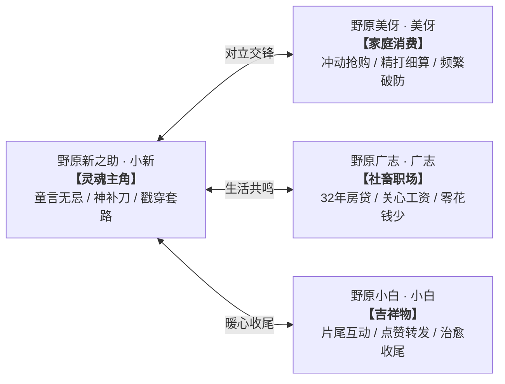
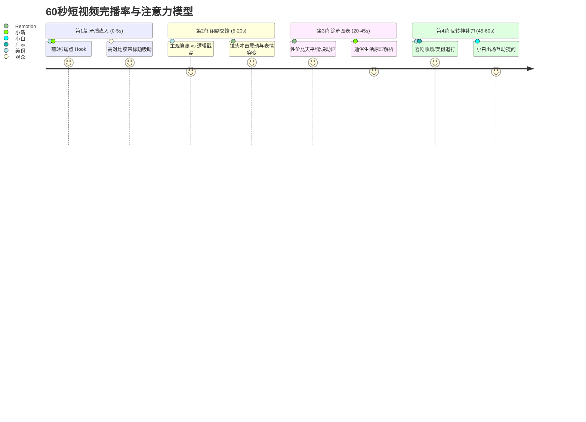
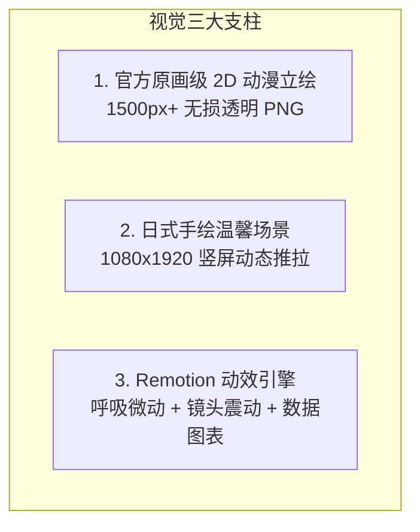

# 《野原经济学》独立新项目架构设计与全流程实施方案

> **项目定位**：基于「蜡笔小新」国民 IP 的泛财经/家庭生活短视频自动化生产流水线  
> **核心 Slogan**：**看野原家闹剧，懂生活经济学**  
> **工程属性**：全新独立工程（Zero-Legacy Greenfield Project），纯净代码库，工业化批量生产  
> **目标规格**：竖屏 1080×1920 / 30fps / 45~65s / 4 幕双人情景剧

---

```mermaid
graph TD
    subgraph 1. 创意与剧本创作层 (Claude Opus / Pro)
        A1[选题池与生活痛点] --> A2[双人情景剧 4 幕剧本生成]
        A2 --> A3[分镜与角色表情/动作编排]
    end

    subgraph 2. 音频与时间轴合成层 (Python + Edge-TTS)
        B1[小新/美伢/广志 角色分配] --> B2[多角色高拟真语音合成]
        B2 --> B3[智能停顿与多轨混音]
        B3 --> B4[精确到毫秒级 Timeline 对齐]
    end

    subgraph 3. 视觉与动效渲染层 (Remotion + React)
        C1[官方正版动漫原画立绘] --> C4[Remotion 视频合成引擎]
        C2[日式温馨手绘场景背景] --> C4
        C3[涂鸦数据图表与镜头震动动效] --> C4
        C4 --> C5[1080P 60fps 最终成片导出]
    end

    subgraph 4. 营销与质检交付层
        D1[2.1 高 CTR 爆款封面生成器]
        D2[全流程自动化 QA 质检校验]
        D3[一键多平台分发包打包]
    end

    A3 --> B1
    B4 --> C4
    C4 --> D1
    C4 --> D2
    D1 & D2 --> D3
```

---

## 一、 全新项目工程目录架构标准

新项目采用现代化、模块化、高聚合的目录结构，彻底告别冗余历史文件：

```text
video-short-nohara/
├── .env.example                     # 环境变量模板（可选 API Key）
├── AGENTS.md                        # 智能体分工与模型自动切换规范
├── GEMINI.md                        # 工作区主模型与子模型协作准则
├── package.json                     # Node 依赖与一键运行脚本
├── remotion.config.ts               # Remotion 视频渲染配置
├── tsconfig.json                    # TypeScript 严谨类型校验配置
│
├── config/                          # 项目级全局配置
│   ├── account_brand.json           # 账号品牌信息、Slogan、矩阵配置
│   ├── character_voices.json        # 角色 TTS 音色、音调、语速参数对照表
│   └── platform_templates.json      # 抖音/小红书/视频号文案与标签模板
│
├── assets/                          # 高清母素材库（统一 1500px+ 2D 动漫手绘）
│   ├── characters/                  # 官方原画角色立绘（透明背景 PNG）
│   │   ├── shin_smile.png           # 小新：微笑/招牌表情
│   │   ├── shin_explaining.png      # 小新：叉腰讲解/挑眉
│   │   ├── shin_thinking.png        # 小新：托下巴困惑
│   │   ├── shin_shocked.png         # 小新：目瞪口呆
│   │   ├── shin_smug.png            # 小新：得瑟得意
│   │   ├── misae_shopping.png       # 美伢：采购兴奋
│   │   ├── misae_angry.png          # 美伢：愤怒破防/追打
│   │   ├── misae_calculating.png    # 美伢：精打细算
│   │   ├── hiroshi_tired.png        # 广志：疲惫叹气/看工资条
│   │   ├── hiroshi_shocked.png      # 广志：被扣零花钱震惊
│   │   └── shiro_happy.png          # 小白：欢快转圈/片尾卖萌
│   ├── backgrounds/                 # 日式动漫手绘场景底图 (1080×1920)
│   │   ├── bg_nohara_living.png     # 野原家客厅（榻榻米、矮桌、暖阳）
│   │   ├── bg_kasukabe_market.png   # 春日部超市（货架、特卖区）
│   │   ├── bg_kasukabe_street.png   # 春日部街道（电线杆、住宅区）
│   │   └── bg_office_desk.png       # 双叶商事办公室（工位电脑）
│   ├── props/                       # 高清道具透明图层
│   │   ├── prop_chocobi.png         # 巧克比鳄鱼饼干盒
│   │   ├── prop_receipt.png         # 购物小票/超市账单
│   │   └── prop_salary_slip.png     # 广志的工资条/零花钱
│   └── audio/                       # 公共音效与 BGM
│       ├── bgm_nohara_daily.mp3     # 蜡笔小新轻快搞笑日常 BGM
│       ├── sfx_pop.mp3              # 气泡弹出音效
│       ├── sfx_cash.mp3             # 收银机清脆到账音效
│       └── sfx_shake.mp3            # 情绪爆发冲击音效
│
├── remotion/                        # Remotion 视频动效合成工程
│   └── src/
│       ├── Root.tsx                 # 根入口与 Composition 注册
│       ├── Main.tsx                 # 核心合成流（转场溶解/时间轴控制）
│       ├── components/              # 动效组件库
│       │   ├── Character.tsx        # 角色渲染（呼吸微动 + 说话跳动 + 描边）
│       │   ├── HookTitle.tsx        # 开场痛点标题（黑黄警示胶带风悬浮贴纸）
│       │   ├── DialogueBubble.tsx   # 漫画对话气泡（动态文字打字机）
│       │   ├── Infographics.tsx     # 涂鸦数据图表（天平/滑块/柱状对比）
│       │   ├── Subtitle.tsx         # 智能弹幕式字幕（关键词高亮放大）
│       │   └── effects/             # 情绪与粒子特效库
│       │       ├── ImpactShake.tsx  # 镜头冲击震动
│       │       ├── SteamEffect.tsx  # 美伢/广志头顶冒烟破防
│       │       └── Sparkles.tsx     # 发现打折/眼睛发光粒子
│       └── scenes/                  # 场景模版
│           ├── NarrationScene.tsx   # 核心情景剧场景（双人站位 + 背景推拉）
│           └── OutroScene.tsx       # 小白互动片尾（问答引导关注）
│
├── scripts/                         # 自动化流水线脚本
│   ├── generate_story.py            # 剧本生成引擎（双人对白 4 幕法则）
│   ├── generate_audio.py            # 多角色 TTS 配音与自动对齐混音
│   ├── generate_cover.py            # 2.1 高 CTR 爆款封面生成器
│   ├── semantic_check.py            # 剧本合规、发音与标点质检
│   ├── render_video.py              # 调用 Remotion 渲染高清成片
│   └── batch_pipeline.py            # 一键全自动批量生产调度器
│
├── shared/                          # 共享数据模型与基础设施
│   ├── llm_router.py                # 智能模型路由器（Opus 思考 / Flash 执行）
│   ├── asset_manager.py             # 素材索引与动态匹配器
│   └── schemas.py                   # Pydantic 剧本与分镜数据规范
│
└── projects/                        # 单条视频项目产出（每一期独立隔离）
    └── P001_第二件半价陷阱/
        ├── script.json              # 结构化剧本与台词
        ├── timeline.json            # 毫秒级音视频时间轴
        ├── audio/                   # 角色单独语音与混音后的 main.mp3
        └── deliverables/            # 交付成果（成片 mp4 + 爆款封面 jpg）
```

---

## 二、 IP 宇宙定位与角色矩阵规范



### 1. 角色人设与音色配置表

| 角色 | 视觉形象标准 | 核心定位 & 叙事功能 | TTS 推荐音色 (Edge-TTS) | 常用情绪立绘 |
| :--- | :--- | :--- | :--- | :--- |
| **小新** | 经典红衣黄裤、圆润大头、浓眉大眼 | **灵魂主角**：童言无忌、一眼看穿本质、戳破商家包装与成年人借口 | `zh-CN-XiaoyiNeural` (+15% Pitch, +5% Speed) | `smile`, `explaining`, `thinking`, `shocked`, `smug` |
| **美伢** | 卷发主妇、粉紫家居服 | **消费/家庭担当**：热衷打折促销、冲动消费、经常被小新一句话问到破防 | `zh-CN-XiaoxiaoNeural` (热情/激动语气) | `shopping`, `angry`, `calculating`, `shocked`, `crying` |
| **广志** | 西装或居家衬衫、胡茬大叔 | **职场/社畜担当**：背负 32 年房贷、关心个税与公积金、零花钱少 | `zh-CN-YunjianNeural` (疲惫沉稳语气) | `tired`, `shocked`, `thinking`, `crying` |
| **小白** | 纯白棉花糖小狗、歪头卖萌 | **片尾吉祥物**：互动收尾、抛出互动问题、引导点赞与评论 | 专属音效 + 俏皮短提示音 | `happy`, `wondering`, `rolling` |

---

## 三、 爆款内容叙事法则：双人情景剧 4 幕黄金模型

每期视频总时长控制在 **45~60 秒**，严格遵循高留存、强节奏的黄金 4 幕节奏：



### 1. 第 1 幕：矛盾直入（0~5s · 黄金前 3 秒 Hook）
- **画面**：场景直入，开场黑黄警示胶带风痛点大标题，美伢兴奋展示“战利品”或广志拿着工资条发呆；
- **对白**：直接抛出日常高频消费现象，瞬间激发受众好奇心；
- **音效**：清脆弹跳音效或警报提示音。

### 2. 第 2 幕：闹剧交锋（5~20s · 制造认知冲突）
- **画面**：双人站位，美伢得意计算省了多少钱，小新突然挑眉泼冷水；
- **对白**：小新童言无忌点破核心痛点（*“美伢，你明明只想吃一盒，为什么多花十块钱买两个不需要的？”*）；
- **动效**：镜头微震动（`Camera Impact Shake`），美伢头顶冒烟破防。

### 3. 第 3 幕：涂鸦图表与原理揭秘（20~45s · 极简生活经济学）
- **画面**：弹出 Remotion 动态涂鸦图表（性价比天平 `Balance`、购买力滑块 `Slider`、价格对比柱状图 `BarChart`）；
- **对白**：用野原家大白话讲清底层逻辑（如价格歧视、边际效用递减、沉没成本陷阱）；
- **动效**：角色保持正弦波自然呼吸微动（`Breathing Idle`），重点关键词黄色高亮弹跳放大。

### 4. 第 4 幕：神补刀反转与互动 Outro（45~60s）
- **画面**：美伢破防追打小新 / 广志看着空钱包叹气；
- **对白**：小新留下一句搞笑金句点题；
- **Outro**：小白登场，弹跳出互动问答卡片（*“你在超市踩过哪些坑？评论区告诉小新！”*），引导完播与评论区讨论。

---

## 四、 视觉质感与动效体系规范



### 1. 角色立绘标准
- **分辨率**：必须为 **1500px 以上** 的官方正版 2D 动漫透明背景 PNG；
- **去背质量**：边缘经过抗锯齿精细处理，无白边、无绿边、无像素噪点；
- **动效赋能**：在 Remotion 中默认应用 `Breathing Idle`（正弦微动），说话角色触发轻微上浮跳动与环境光晕描边。

### 2. 2.1 高 CTR 爆款封面规范
封面是短视频在信息流中点击率的决定性因素，新项目采用标准化的**四层视觉构图法**：
1. **背景层**：模糊度 5px 的春日部超市/野原家客厅插画，营造日系动漫氛围；
2. **标题层（黄金分割区）**：
   - **主标题**：黑黄高饱和度警示胶带风底色，倾斜 -2°，14~18 字直击人性焦虑与好奇；
   - **副标题**：黑底白字红标，提炼核心反常识痛点；
3. **主体层**：小新/美伢/广志立绘放大至画面 **55%~60%**，具备立体深阴影；
4. **贴纸层**：右上角醒目色块悬念贴纸（如 `[ 价格歧视 ]`、`[ 智商税 ]`、`[ 工资真相 ]`）。

---

## 五、 智能体分流与模型自动协同架构

新项目原生遵循「**工具内置智能分配为主，零 API 成本运行，按需脚本 API 增强**」准则：

```mermaid
graph TD
    UserReq[新视频创作/系统开发] --> Router{工作类型判定}
    Router -->|复杂创意 / 4幕剧本创作 / 分镜编排| Pro[Claude Opus / Pro Subagents<br>高阶推理中枢]
    Router -->|代码编写 / TTS 配音 / 视频渲染 / 质检| Flash[Gemini 3.7 Flash<br>日常极速执行引擎]
    
    subgraph 独立脚本环境 (shared/llm_router.py)
        ScriptReq[Python 命令行运行] --> KeyCheck{检查 .env 配置}
        KeyCheck -->|配置了 Key| RemoteAPI[调用 Opus / Gemini API]
        KeyCheck -->|未配置 Key| Fallback[本地高品质模板库降级]
    end
```

1. **思考与设计层 (Claude Opus / Pro Subagents)**：
   - 负责：深度故事构思、反常识点挖掘、双人矛盾台词编排、视觉分镜设计；
   - 触发：开发工具中通过 `invoke_subagent(Model: 'pro')` 自动唤起。
2. **日常与执行层 (Gemini 3.7 Flash)**：
   - 负责：Python 脚本调试、Remotion React 组件渲染、TTS 配音与混音、代码重构与质检；
   - 触发：主智能体极速响应，秒级出片。
3. **零外部成本回退机制**：
   - 即使脱离网络或无外部 API Key，底层流水线依然可通过预置的 `config/` 本地模板库全速渲染成片。

---

## 六、 结构化数据 Schema 规范

### 1. 剧本定义 (`projects/Pxxx/script.json`)
```json
{
  "videoId": "P001",
  "title": "第二件半价陷阱",
  "topic": "价格歧视与边际效用",
  "characters": ["小新", "美伢"],
  "targetDuration": 55,
  "hook": "你以为买两件省钱，其实被商家掏空了钱包！",
  "dialogues": [
    {
      "sceneId": "S01",
      "speaker": "美伢",
      "emotion": "shopping",
      "text": "哇！小新快看，这盒巧克比第二件半价，一口气买两盒立省十块钱，我真是个持家小能手！",
      "background": "春日部超市",
      "prop": "巧克比",
      "effect": "none"
    },
    {
      "sceneId": "S02",
      "speaker": "小新",
      "emotion": "explaining",
      "text": "诶？美伢，你明明只想吃一盒吧？多掏十块钱买不需要的东西，商家都乐开花啦！",
      "background": "春日部超市",
      "prop": "巧克比",
      "effect": "shake"
    }
  ]
}
```

### 2. 时间轴与分镜定义 (`projects/Pxxx/timeline.json`)
```json
{
  "videoId": "P001",
  "title": "第二件半价陷阱",
  "totalDuration": 52.4,
  "audioFile": "audio/main.mp3",
  "scenes": [
    {
      "sceneId": "S01",
      "start": 0.0,
      "end": 6.8,
      "speaker": "美伢",
      "background": "春日部超市",
      "characterEffect": "none",
      "infographic": {
        "kind": "balance",
        "title": "性价比天平",
        "leftLabel": "1件原价",
        "rightLabel": "2件半价",
        "tilt": "right"
      },
      "elements": [
        {"type": "character", "name": "小新", "emotion": "thinking", "position": "left"},
        {"type": "character", "name": "美伢", "emotion": "shopping", "position": "right"}
      ],
      "subtitle": {
        "text": "哇！小新快看，这盒巧克比第二件半价，一口气买两盒立省十块钱！",
        "highlights": ["第二件半价", "立省十块钱"]
      }
    }
  ]
}
```

---

## 七、 从零搭建全新项目操作指南 (Day 1 Bootstrap Guide)

### 步骤 1：新建独立代码仓库与初始化
```bash
mkdir video-short-nohara && cd video-short-nohara
git init
npm init -y
python3 -m venv .venv
source .venv/bin/activate
```

### 步骤 2：安装核心依赖
- **Node.js (Remotion 视觉引擎)**：
  ```bash
  npm install remotion @remotion/cli @remotion/bundler react react-dom
  npm install -D typescript @types/react @types/node
  ```
- **Python (剧本、TTS 与音频引擎)**：
  ```bash
  pip install edge-tts pydub pillow requests pydantic
  ```

### 步骤 3：部署官方高清素材
将 1500px+ 官方原版透明 PNG 立绘放入 `assets/characters/`，场景底图放入 `assets/backgrounds/`。

### 步骤 4：一键生成第一支蜡笔小新短视频
```bash
# 1. 构思剧本
python scripts/generate_story.py --topic "超市第二件半价真的省钱吗" --output projects/P001

# 2. 生成配音与音频对齐
python scripts/generate_audio.py --project projects/P001

# 3. 生成 2.1 爆款封面
python scripts/generate_cover.py --project projects/P001

# 4. Remotion 自动渲染成片
npm run render -- projects/P001
```

---

## 八、 总结与项目愿景

本方案为《野原经济学》短视频生产提供了一个**零历史包袱、纯净模块化、高度工业化**的全新起点：
- **内容上**：依托野原一家天然的幽默与反套路特质，将晦涩的财经知识转化为 1 分钟爆款情景喜剧；
- **视觉上**：以官方正版 2D 原画为基石，结合 Remotion 现代化动效，彻底告别低质拼凑感；
- **工程上**：双模型智能分工 + 模块化 Schema 数据流，实现一人即团队的批量日更高质量输出。
